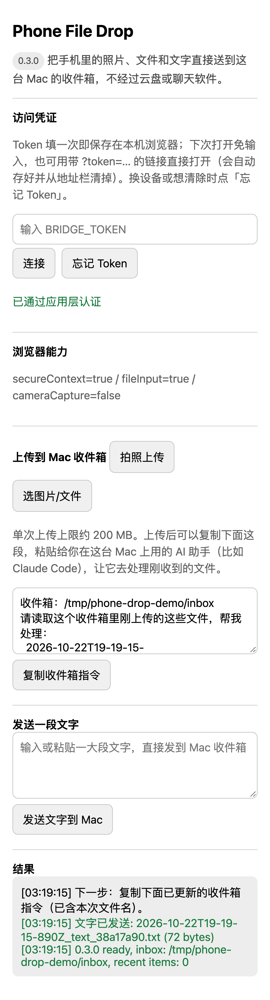

# Phone Drop

用任意手机的浏览器，把照片、文件和文字直接送进 Mac 上的一个收件箱文件夹——走你信任的局域网或 Tailscale，手机上什么都不用装。

> **状态：** 稳定 · 低频维护 · 2026-10 最后核验（v0.3.0）。2026 年 10 月由 `iphone-sensor-bridge-poc` 改名而来，旧的 GitHub 链接会自动跳转到这里。
>
> **手机网页是中文界面**（简体），暂无英文版。

[English](README.md)



## 三步上手

1. **生成 Token**（一次）：在权限 `700` 的目录里 `openssl rand -hex 32 > ~/.config/phone-drop/token`，文件权限 `600`（完整命令见[局域网或 Tailscale 运行](#局域网或-tailscale-运行)）。
2. **在 Mac 的 Tailscale 或局域网地址上启动**：`HOSTS=<那个地址> BRIDGE_TOKEN_FILE=~/.config/phone-drop/token npm start`，或用 `BRIDGE_LISTEN_HOSTS=<那个地址> npm run launchd:install` 装成常驻服务。
3. **手机打开 `http://<那个地址>:8765`**，填一次 Token，然后拍照、选文件或发一大段文字，全部落到 `~/Desktop/phone-drop-inbox`。

每次上传后，页面会给出一段简短说明（收件箱路径加本次文件名），复制后粘贴给你在 Mac 上用的 AI 助手（比如 Claude Code），它就能去处理这些文件。

## 和其他方案比

| | 可用设备 | 手机要装 App 吗 | Mac 可以不在身边吗 | 能直接发文字吗 |
|---|---|---|---|---|
| AirDrop | 只限 iPhone / Apple 设备 | 不用（系统自带） | 不行，必须在附近 | 能 |
| [Taildrop](https://tailscale.com/kb/1106/taildrop) | tailnet 里的任意设备 | 要装 Tailscale | 可以 | 不能，只传文件 |
| [LocalSend](https://localsend.org) | 大多数平台 | 要装 LocalSend | 不行，要同一网络 | 能 |
| **Phone Drop** | 任何有浏览器的手机 | 不用（浏览器即可；Mac 不在身边时才需要 Tailscale） | 可以，走 Tailscale | 能 |

适合用 Phone Drop 的情况：手机不是 Apple 设备、或者不方便装 App；想让每次投递都落到 Mac 上固定的收件箱文件夹；或者想把收到的文件直接交给 AI 助手处理。如果你在普通局域网里需要端到端加密（Phone Drop 走局域网时是明文 HTTP），或者需要双向互传，选上面其他方案更合适。

## 安全边界

- `GET /` 是无需认证的应用外壳，不包含服务端 Token，也不包含受保护的收件箱信息。
- `GET /api/health` 可匿名访问，但只返回服务状态和版本。
- 配置 Token 后，其余 `/api/*` 路由都要求 `Authorization: Bearer <token>`。
- 旧的 `x-bridge-token` 请求头不再接受。
- 只要监听地址里有一个不是 loopback，启动时就必须通过 `BRIDGE_TOKEN` 或 `BRIDGE_TOKEN_FILE` 提供至少 32 字符、可用于 Bearer 的 Token，否则服务拒绝启动。仓库内不再提供固定或可预测的默认 Token。
- 网页要求用户手动输入 Token，保存在 `localStorage` 中——跨标签页、重启浏览器都不会丢，直到点网页上的「忘记 Token」按钮清除；也支持用带 `?token=...` 的链接直接打开，存好后立刻从地址栏清掉。服务端访问日志只记录请求路径，不记录 query string。
- 默认忽略 `X-Forwarded-For`。只有服务确实位于可信反向代理之后，而且代理会用已验证的客户端地址覆盖该请求头，或追加它直接观察到的客户端地址时，才设置 `TRUST_PROXY=true`。限流使用最右侧的有效地址，标准追加模式下，客户端伪造在左侧的值不能绕过限流。原样透传客户端请求头的代理不安全，不能启用该选项。

Tailscale 和 Bearer Token 管的是两层边界：Tailscale 决定哪些设备能连到这个 HTTP 服务，Token 决定哪些请求能查看收件箱信息或投递内容。不要把端口直接暴露到公网。直接走局域网时仍是明文 HTTP，只应在可信局域网或 Tailscale 路径中使用。

## 运行要求

- LaunchAgent 安装脚本需要 macOS；服务本身是纯 Node.js
- Node.js 18 或更高版本
- 不需要安装 npm 外部依赖

## 仅本机运行

只监听 loopback 时可以不设 Token：

```sh
npm start
```

默认地址为 `127.0.0.1:8765`，默认收件箱为 `~/Desktop/phone-drop-inbox`。

## 局域网或 Tailscale 运行

先在本机生成高熵 Token，并保存在 Git 仓库之外的私有文件：

```sh
mkdir -p "$HOME/.config/phone-drop"
chmod 700 "$HOME/.config/phone-drop"
umask 077
openssl rand -hex 32 > "$HOME/.config/phone-drop/token"
chmod 600 "$HOME/.config/phone-drop/token"

cp .env.example .env
chmod 600 .env
```

编辑 `.env`：把 `HOSTS` 改成需要的非 loopback 地址，并设置 `BRIDGE_TOKEN_FILE=$HOME/.config/phone-drop/token`。优先填写 Mac 的确切 Tailscale 地址（`tailscale ip -4`）；只有确实想让所有网卡都能访问时才用 `0.0.0.0`。启动前加载这份本机环境：

```sh
set -a
. ./.env
set +a
npm start
```

手机打开局域网或 Tailscale 地址后，输入同一个 Token 再连接；也可以直接打开带 `?token=...` 的链接免输入。Token 保存在 `localStorage` 中，关闭标签页不会清除，需要点网页上的「忘记 Token」按钮才会清除。

## 安装 LaunchAgent

仓库跟踪的 plist 和安装后的 LaunchAgent 都不包含 Token。安装脚本会隐藏输入内容，把 Token 存进 `~/.config/phone-drop/token`（目录权限 `700`、文件权限 `600`），随后重启 LaunchAgent `local.phone-drop`。服务会拒绝符号链接、错误属主、宽松权限和格式不合格的值：

```sh
BRIDGE_LISTEN_HOSTS=<你的 Tailscale 或局域网地址> npm run launchd:install
```

`BRIDGE_LISTEN_HOSTS` 必填；没填时安装脚本会提示后退出，避免服务不小心监听所有网卡。确实要监听所有网卡就显式传 `0.0.0.0`。非交互安装时，可由本机 secret store 通过进程环境传入 `BRIDGE_TOKEN`；还可用 `BRIDGE_INBOX`、`BRIDGE_NODE_BIN` 覆盖收件箱或 Node 可执行文件，路径类覆盖值必须是绝对路径。仓库内的 plist 是可移植模板，安装脚本会按当前机器填入用户目录、仓库、可执行文件和日志路径。脚本不会打印 Token，也不会把它放进进程参数。

## 配置项

- `HOSTS`：逗号分隔的监听地址，默认 `127.0.0.1`。
- `PORT`：默认 `8765`。
- `INBOX`：投递目录，默认 `~/Desktop/phone-drop-inbox`。
- `BRIDGE_TOKEN`：直接提供 Token；存在非 loopback 监听地址时至少 32 字符。
- `BRIDGE_TOKEN_FILE`：launchd 推荐的 Token 来源；必须是当前用户拥有、权限为 `600` 的普通文件。
- `MAX_BODY`：单次上传字节上限，默认 200 MiB。
- `TRUST_PROXY`：默认 false；只在直接访问已限制到可信反向代理，且代理会覆盖转发地址或追加它直接观察到的客户端地址时启用。

## 从 iphone-sensor-bridge-poc 升级

v0.3.0 改了默认名称。已经装好的实例在你重新安装之前照常运行。想沿用旧的收件箱和 Token，这样重装：

```sh
BRIDGE_LISTEN_HOSTS=<地址> \
BRIDGE_INBOX="$HOME/Desktop/iphone-sensor-inbox-v2" \
BRIDGE_TOKEN_FILE="$HOME/.config/iphone-sensor-bridge-poc/token" \
npm run launchd:install
```

然后卸掉旧的 LaunchAgent：`launchctl bootout gui/$(id -u)/com.alice.iphone-sensor-bridge-poc`，再把 `~/Library/LaunchAgents/com.alice.iphone-sensor-bridge-poc.plist` 移到废纸篓。如果你 clone 过旧仓库，用 `git remote set-url origin git@github.com:AliceLJY/phone-drop.git` 更新远程地址。

## 验证

```sh
npm run check
npm test
curl -s http://127.0.0.1:8765/api/health
```

受保护 API 的调用示例：

```sh
curl -H 'Authorization: Bearer <从本机-secret-store读取的-token>' \
  http://127.0.0.1:8765/api/items
```

CI 会在 Node.js 18、20、22 上运行语法检查和关键行为测试。

配置多个 `HOSTS` 时，所有地址都监听成功才算启动成功。任一地址绑定失败，服务会关闭已经打开的监听并以非零状态退出，让 launchd 重启，避免留下只开放部分地址的半残服务。
